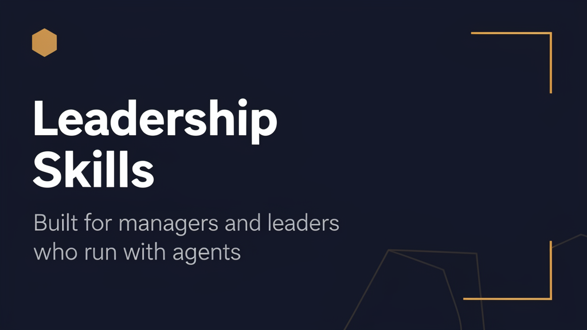

# Leadership Skills

[](https://github.com/stephenrogan/leadership-skills/blob/main/assets/banner.png)

## Install

**One-line install (GitHub CLI v2.90+):**

    gh skill install stephenrogan/leadership-skills <skill-name> --agent claude-code

**Or with npx:**

    npx skills add stephenrogan/leadership-skills

**No terminal? No problem:**
Download any skill folder from `skills/` and upload it to Claude (claude.ai → attach the folder in a conversation, or add it to a Project). Works immediately, no setup.

Agent Skills for leaders managing humans, agents, workflows, memory, and governance.

This is not a prompt pack. It is a leadership operating layer: reusable skills that help an agent prepare the messy work around management so the human leader can spend more time on judgment, trust, coaching, influence, and accountability.

The agent prepares. The human decides.

## Who this is for

Primary users:

1. Founders and operators running AI-heavy teams
2. Functional leaders managing humans plus agent workflows
3. Chiefs of staff and operators turning messy context into decisions
4. Managers who want repeatable preparation for 1:1s, feedback, delegation, meetings, hiring, performance, and change

## What this repo is

A library of Agent Skills-compatible workflow packages. Each skill includes:

```text
skills/<skill-name>/
  SKILL.md
  references/framework.md
  assets/output-template.md
  evals/evals.json
```

Each skill is designed to produce a concrete artifact: memo, brief, plan, map, agenda, tracker, script, decision record, eval suite, or operating cadence.

## What this repo is not

- Not a replacement for managers
- Not HR, legal, or finance advice
- Not permission for agents to send messages, make employment decisions, promise customers, spend money, or publish externally
- Not a collection of generic leadership slogans

## The boundary

All skills obey the same operating boundary:

| Agent may | Human owns |
|---|---|
| Gather context | Final decisions |
| Synthesize notes | Employment actions |
| Structure options | Compensation and hiring calls |
| Draft memos and scripts | External messages and commitments |
| Run premortems and reviews | Legal, HR, finance, customer, and reputation risk |
| Track follow-up | Consequences |

If the work touches people, customers, budget, legal/compliance exposure, reputation, or external communication, the skill prepares the packet and stops for human approval.

## Start here

If you only try five skills, start with these:

| Skill | Use it when | Output |
|---|---|---|
| `decision-memo` | A choice is important, ambiguous, or keeps getting reopened | One-page decision memo with options, tradeoffs, recommendation, dissent, and revisit trigger |
| `manager-one-on-one-prep` | A manager needs a better 1:1 than status updates | Prep brief with context, commitments, risks, coaching questions, and follow-up |
| `stakeholder-prewire` | A decision needs influence before the meeting | Stakeholder map, objections, sequence, and alignment tracker |
| `weekly-leadership-pack` | A leader needs the week compressed into decisions and risks | One-page operating brief across metrics, people, customers, priorities, and asks |
| `agent-command-center` | Multiple agents or workflows are running and becoming hard to see | Command-center view of owners, states, blockers, approvals, risks, and next decisions |

## Skill bundles

### Manager OS

Weekly workflows that make managers more prepared and less reactive.

- `manager-one-on-one-prep`
- `feedback-conversation-prep`
- `delegation-brief`
- `staff-meeting-designer`
- `weekly-leadership-pack`

### Leadership Judgment

Decision quality, influence, risk, and executive communication.

- `decision-memo`
- `premortem-runner`
- `stakeholder-prewire`
- `executive-update-brief`
- `change-cascade`

### People and Org

Sensitive talent, performance, team health, hiring, succession, and conflict workflows.

- `performance-cycle`
- `onboarding-ramp`
- `talent-calibration`
- `succession-coverage-map`
- `hiring-loop`
- `team-health-pulse`
- `conflict-mediation-prep`

### Strategic Influence

Strategy, org design, customer escalation, board narrative, and leadership learning loops.

- `org-design-options`
- `customer-escalation-recovery`
- `strategy-operating-system`
- `market-and-board-narrative`
- `leadership-learning-loop`

### AI-Native Operating System

Workflows for leaders managing portfolios of humans, agents, tools, memory, evals, and approval gates.

- `agent-workforce-architecture`
- `agent-delegation-brief`
- `agent-output-review`
- `agent-command-center`
- `agent-performance-management`
- `context-memory-ops`
- `agent-risk-governance`
- `human-agent-team-design`
- `agent-eval-design`
- `agent-improvement-backlog`

## Quickstart

1. Pick the skill that matches the leadership job.
2. Load the skill folder in an Agent Skills-compatible client.
3. Provide live context: notes, metrics, prior decisions, stakeholder list, meeting goal, or workflow state.
4. Ask for the artifact, not generic advice.
5. Review the human decision boundary before using, sending, or acting on anything.

Example:

```text
Use skills/decision-memo. We need to decide whether to move enterprise renewals from named CSM ownership to pooled coverage. Build the decision memo with options, tradeoffs, assumptions, dissent, and revisit criteria. Do not make the final decision.
```

Boundary example:

```text
Use skills/feedback-conversation-prep. Prepare the conversation, but do not decide whether this becomes a formal HR action.
```

## Examples

See `examples/` for synthetic before/after examples showing how structured skills improve output quality over generic prompts.

Flagship examples:

- `examples/decision-memo/`
- `examples/manager-one-on-one-prep/`
- `examples/stakeholder-prewire/`
- `examples/weekly-leadership-pack/`
- `examples/agent-command-center/`

All examples are synthetic. Do not add real employee, customer, employer, or private meeting data.

## Validation and evals

Install dependencies and run the full local gate:

```bash
python3 -m pip install -r requirements.txt
make qa
```

Equivalent commands:

```bash
python3 scripts/validate_repo.py
python3 -m unittest discover -s tests -v
python3 scripts/run_evals.py --summary
```

The repo currently gates on:

- Agent Skills package structure
- YAML frontmatter schema
- README catalog coverage
- required references, templates, and eval files
- safety and human-boundary language
- deterministic smoke evals
- unit tests

The deterministic smoke eval runner does not claim to grade live model behavior. It proves eval cases are packaged, complete, boundary-aware, and release-auditable without requiring secrets. Model-backed evals can be layered on top by a compatible client.

## Full catalog

| Skill | Tier | Role | Job |
|---|---|---|---|
| `agent-command-center` | tier-5-mega-manager | Manager cockpit designer | Creates a command-center view for managing multiple AI agents and human-agent workflows, including active work, owners, state, blockers, quality signals, risk level, approvals, and next decisions. |
| `agent-delegation-brief` | tier-5-mega-manager | Agent delegation designer | Turns a leadership task into an agent-ready delegation brief with objective, context, inputs, tools, constraints, acceptance criteria, escalation triggers, and verification plan. |
| `agent-eval-design` | tier-5-mega-manager | Evaluation architect | Designs practical evals for leadership and management agent skills, including realistic prompts, expected outputs, assertions, negative tests, boundary tests, and human grading rubrics. |
| `agent-improvement-backlog` | tier-5-mega-manager | Continuous improvement operator | Converts agent failures, user corrections, eval misses, review notes, and workflow friction into a prioritized improvement backlog. |
| `agent-output-review` | tier-5-mega-manager | Quality gatekeeper | Reviews AI agent outputs for correctness, evidence, completeness, safety, decision boundaries, and usability before a leader relies on them. |
| `agent-performance-management` | tier-5-mega-manager | AI worker performance manager | Evaluates AI agent performance over time using task outcomes, acceptance rate, revision causes, error patterns, latency, cost, risk incidents, and user trust. |
| `agent-risk-governance` | tier-5-mega-manager | AI governance operator | Creates governance for AI agents with risk classes, approval gates, audit logs, access controls, red lines, incident response, and rollback rules. |
| `agent-workforce-architecture` | tier-5-mega-manager | AI workforce architect | Designs a human-plus-agent workforce architecture with roles, work classes, autonomy levels, escalation paths, tool access, memory boundaries, and operating cadence. |
| `change-cascade` | tier-2-leadership-judgment | Change leader | Plans how to communicate and operationalize a change through managers and teams, including rationale, audience impact, FAQ, resistance risks, adoption measures, and reinforcement cadence. |
| `conflict-mediation-prep` | tier-3-people-and-org | Conflict de-escalator | Prepares a neutral conflict mediation plan by separating facts, interpretations, interests, stakes, possible agreements, conversation structure, and follow-up commitments. |
| `context-memory-ops` | tier-5-mega-manager | Context and memory steward | Designs context, memory, and knowledge flows for agent-managed work: what agents should know, retrieve, remember, forget, cite, and never store. |
| `customer-escalation-recovery` | tier-4-strategic-influence | Customer risk and trust restorer | Builds an executive customer escalation recovery brief with timeline, commitments, stakeholders, risk exposure, root-cause hypotheses, response plan, and approval-required concessions. |
| `decision-memo` | tier-2-leadership-judgment | Decision architect | Creates a concise decision memo with context, decision required, options, tradeoffs, assumptions, dissent, recommendation, owner, and revisit criteria. |
| `delegation-brief` | tier-1-manager-os | Leverage builder | Converts fuzzy delegation into a crisp ownership brief with outcome, context, constraints, decision rights, checkpoints, risks, and success criteria. |
| `executive-update-brief` | tier-2-leadership-judgment | Executive communicator | Creates an executive-ready update brief with headline narrative, evidence, risks, decisions needed, owner asks, and anticipated questions. |
| `feedback-conversation-prep` | tier-1-manager-os | Standard setter and coach | Turns observed behaviour and impact into a fair, specific feedback conversation plan with evidence, SBI-style framing, likely reactions, and follow-up. |
| `hiring-loop` | tier-3-people-and-org | Team builder | Creates a structured hiring loop with role scorecard, competencies, interview plan, question bank, evidence rubric, debrief packet, and bias checks. |
| `human-agent-team-design` | tier-5-mega-manager | Team operating model designer | Designs how humans and AI agents collaborate inside a team, including roles, handoffs, rituals, shared artifacts, escalation norms, trust-building, and anti-patterns. |
| `leadership-learning-loop` | tier-4-strategic-influence | Reflective system improver | Runs a leadership learning loop by reviewing decisions, outcomes, missed signals, behaviour patterns, system failures, and commitments for improvement. |
| `manager-one-on-one-prep` | tier-1-manager-os | Coach and context keeper | Prepares a manager for high-quality 1:1s by synthesizing prior notes, commitments, performance signals, blockers, career goals, and coaching questions. |
| `market-and-board-narrative` | tier-4-strategic-influence | Strategic narrator | Builds a board or market narrative from internal performance, customer evidence, market shifts, competitive signals, strategic bets, and decision asks. |
| `onboarding-ramp` | tier-3-people-and-org | Talent accelerator | Builds a 30/60/90 onboarding and ramp plan with learning path, stakeholder map, early wins, role expectations, check-ins, and risk signals. |
| `org-design-options` | tier-4-strategic-influence | Org architect | Generates organisation design options with strategy fit, customer segmentation, capacity, spans, roles, tradeoffs, transition risks, and communication implications. |
| `performance-cycle` | tier-3-people-and-org | Fairness and standards operator | Assembles fair performance review or improvement-cycle material by organizing evidence against role expectations, strengths, gaps, support actions, and follow-up criteria. |
| `premortem-runner` | tier-2-leadership-judgment | Risk thinker | Runs a structured pre-mortem for a plan, initiative, launch, reorg, or strategic bet by imagining failure, identifying causes, leading indicators, mitigations, owners, and pause or kill criteria. |
| `staff-meeting-designer` | tier-1-manager-os | Cadence owner | Designs a staff or team meeting that prioritizes decisions, risks, and alignment over status reporting. |
| `stakeholder-prewire` | tier-2-leadership-judgment | Organisational influencer | Builds a stakeholder prewire plan with influence map, likely objections, conversation sequence, audience-specific framing, decision asks, and alignment tracker. |
| `strategy-operating-system` | tier-4-strategic-influence | Strategy-to-execution architect | Turns strategy into an operating system with priorities, bets, decision calendar, metrics, operating cadence, owner map, risks, and kill criteria. |
| `succession-coverage-map` | tier-3-people-and-org | Org risk manager | Maps critical roles, coverage gaps, bench readiness, vacancy risk, ramp time, and development moves for succession and continuity planning. |
| `talent-calibration` | tier-3-people-and-org | Talent developer | Prepares talent calibration material by assembling performance evidence, scope, growth trajectory, readiness hypotheses, risks, and development actions. |
| `team-health-pulse` | tier-3-people-and-org | Culture and team health sensor | Synthesizes team health signals from surveys, 1:1 themes, meeting behaviour, workload, attrition indicators, and execution patterns into risks and interventions. |
| `weekly-leadership-pack` | tier-1-manager-os | Sensemaker and operator | Synthesizes the weekly leadership picture across metrics, risks, people, customers, priorities, and decisions into a one-page operating brief. |

## Public examples and privacy

Use synthetic data in public examples and issues. If you want to apply a skill to real work, keep sensitive context in your private client, not in this repository.

Do not open issues or PRs with real names, real customer data, private employer context, transcripts, confidential metrics, or secrets.

More from the author at [www.stephenrogan.com](https://www.stephenrogan.com).

## License

MIT. See `LICENSE`.
